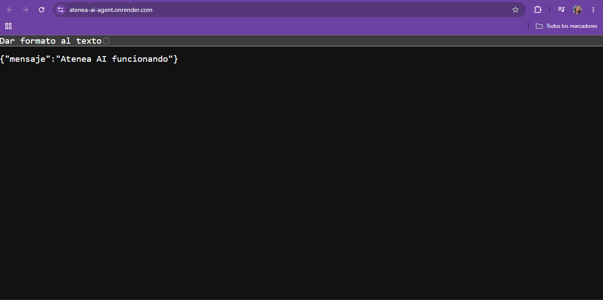

# 🤖 Atenea AI Agent

> Agente Inteligente con arquitectura **RAG (Retrieval-Augmented Generation)** desarrollado como parte del **Challenge Alura + Oracle Next Education**.

---

## 📌 Descripción

Atenea AI Agent es un asistente inteligente capaz de responder preguntas utilizando únicamente la información contenida en documentos internos de una organización.

La aplicación procesa documentos corporativos, los indexa mediante **ChromaDB** y permite realizar consultas a través de una API desarrollada con **FastAPI**.

Su objetivo es proporcionar respuestas precisas basadas en evidencia documental, evitando generar información que no exista en la base de conocimiento.

---

# 🚀 Aplicación desplegada

**Deploy en Render**

🔗 https://atenea-ai-agent.onrender.com

Documentación de la API:

🔗 https://atenea-ai-agent.onrender.com/docs

---

# 🏗 Arquitectura

```text
                Usuario
                   │
                   ▼
             FastAPI (API)
                   │
                   ▼
             Atenea AI Agent
                   │
                   ▼
       Búsqueda Vectorial (ChromaDB)
                   │
                   ▼
      Documentos Indexados (RAG)
                   │
                   ▼
              Respuesta Final
```

---

# ⚙️ Tecnologías utilizadas

- Python 3
- FastAPI
- Uvicorn
- ChromaDB
- LangChain
- Pandas
- OpenPyXL
- PyPDF
- python-docx

---

# 📂 Estructura del proyecto

```text
atenea-ai-agent/

│
├── backend/
│   ├── agent.py
│   ├── chunker.py
│   ├── config.py
│   ├── loaders.py
│   ├── main.py
│   ├── utils.py
│   └── vector_store.py
│
├── documents/
│   ├── comercial/
│   ├── financiero/
│   ├── legal/
│   ├── operaciones/
│   ├── recursos_humanos/
│   └── tecnologia/
│
├── database/
│
├── images/
│
├── README.md
└── requirements.txt
```

---

# 🔄 Flujo del sistema

1. Cargar documentos.
2. Extraer el contenido.
3. Dividir el texto en fragmentos (Chunks).
4. Generar metadatos.
5. Indexar los documentos en ChromaDB.
6. Recibir preguntas mediante FastAPI.
7. Buscar información relacionada.
8. Generar la respuesta.

---

# 💬 Ejemplos de preguntas

- ¿Cuándo debo solicitar vacaciones?
- ¿Qué beneficios tienen los colaboradores?
- ¿Cuál es la política de compras?
- ¿Cómo funciona el protocolo de emergencias?
- ¿Cuál es la política de privacidad?

---

# ▶️ Instalación

Crear entorno virtual

```bash
python -m venv venv
```

Activar entorno

### Windows

```bash
venv\Scripts\activate
```

Instalar dependencias

```bash
pip install -r requirements.txt
```

Indexar documentos

```bash
python -m backend.vector_store
```

Ejecutar la API

```bash
uvicorn backend.main:app --reload
```

Abrir documentación

```
http://127.0.0.1:8000/docs
```

---

# 📸 Evidencias del proyecto

## 🌐 Aplicación desplegada en Render


---

## 🏠 Página principal



---

## 📖 Documentación de la API


---

## 🤖 Ejemplo de consulta

Pregunta:

> ¿Cuándo debo solicitar vacaciones?


---

# ✅ Resultado

El agente responde preguntas utilizando únicamente la información almacenada en los documentos indexados.

Cada respuesta incluye:

- Documento consultado.
- Categoría.
- Fragmento encontrado.
- Contenido relacionado.

Esto demuestra el funcionamiento de una arquitectura **RAG**, donde la información se recupera desde una base documental antes de generar la respuesta.

---

# 👩‍💻 Autor

**Laura Daniela Paucara Cusi**

Ingeniera en Metalurgia

Challenge **Alura + Oracle Next Education**