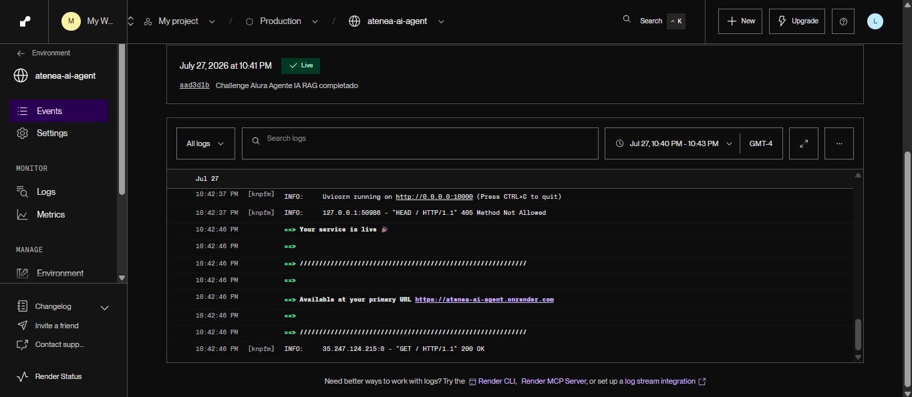
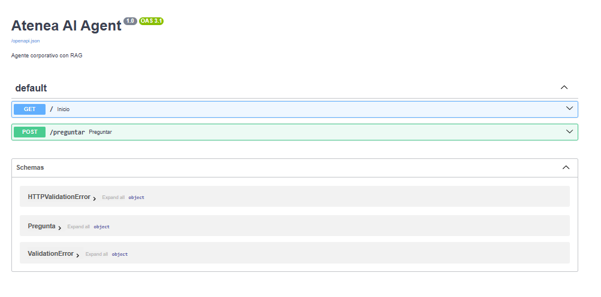
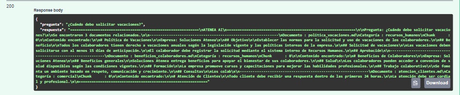

# 🤖 Atenea AI Agent

<p align="center">


</p>

<p align="center">

# 🧠 Agente Inteligente basado en Arquitectura RAG

### Challenge Alura + Oracle Next Education

</p>

---

# 📑 Índice

- [Descripción](#descripción)
- [Objetivos](#objetivos)
- [Aplicación desplegada](#aplicación-desplegada)
- [Arquitectura](#arquitectura)
- [Tecnologías utilizadas](#tecnologías-utilizadas)
- [Estructura del proyecto](#estructura-del-proyecto)
- [Flujo del sistema](#flujo-del-sistema)
- [Ejemplos de preguntas](#ejemplos-de-preguntas)
- [Instalación](#instalación)
- [Evidencias del proyecto](#evidencias-del-proyecto)
- [Resultado](#resultado)
- [Mejoras futuras](#mejoras-futuras)
- [Autor](#autor)

---

# 📖 Descripción

**Atenea AI Agent** es un agente inteligente desarrollado como parte del **Challenge Alura + Oracle Next Education**.

El proyecto implementa una arquitectura **Retrieval-Augmented Generation (RAG)** para responder preguntas utilizando exclusivamente la información almacenada en documentos corporativos.

Los documentos son procesados e indexados mediante **ChromaDB**, permitiendo realizar búsquedas semánticas y generar respuestas fundamentadas en la información recuperada.

El objetivo principal es ofrecer respuestas precisas, evitando generar información que no exista en la base documental.

---

# 🎯 Objetivos

- Centralizar la documentación interna.
- Facilitar la búsqueda de información.
- Reducir tiempos de consulta.
- Implementar una arquitectura RAG.
- Evitar respuestas inventadas mediante recuperación documental.
- Exponer el servicio mediante una API REST con FastAPI.

---

# 🚀 Aplicación desplegada

## 🌐 Render

https://atenea-ai-agent.onrender.com

## 📚 Documentación de la API

https://atenea-ai-agent.onrender.com/docs

---

# 🏗 Arquitectura

```text
                   Usuario
                      │
                      ▼
               FastAPI REST API
                      │
                      ▼
               Atenea AI Agent
                      │
                      ▼
        Búsqueda Vectorial (ChromaDB)
                      │
                      ▼
        Documentos Corporativos
                      │
                      ▼
          Respuesta basada en evidencia
```

---

# ⚙ Tecnologías utilizadas

| Tecnología | Función |
|------------|---------|
| Python 3 | Lenguaje principal |
| FastAPI | API REST |
| Uvicorn | Servidor ASGI |
| ChromaDB | Base de datos vectorial |
| LangChain | Arquitectura RAG |
| Pandas | Lectura de CSV y Excel |
| OpenPyXL | Procesamiento de Excel |
| PyPDF | Lectura de PDF |
| python-docx | Lectura de documentos Word |

---

# 📂 Estructura del proyecto

```text
atenea-ai-agent/

│
├── backend/
│   ├── agent.py
│   ├── chunker.py
│   ├── config.py
│   ├── loaders.py
│   ├── main.py
│   ├── utils.py
│   └── vector_store.py
│
├── database/
│
├── documents/
│   ├── comercial/
│   ├── financiero/
│   ├── legal/
│   ├── operaciones/
│   ├── recursos_humanos/
│   └── tecnologia/
│
├── images/
│   ├── inicio-render.png
│   ├── swagger.png
│   ├── pregunta-vacaciones.png
│   └── render-live.png
│
├── README.md
└── requirements.txt
```

---

# 🔄 Flujo del sistema

1. Cargar documentos.
2. Extraer contenido.
3. Dividir el texto en fragmentos (Chunks).
4. Generar metadatos.
5. Indexar documentos en ChromaDB.
6. Recibir preguntas mediante FastAPI.
7. Buscar los documentos más relevantes.
8. Generar una respuesta basada en evidencia documental.

---

# 💬 Ejemplos de preguntas

- ¿Cuándo debo solicitar vacaciones?
- ¿Qué beneficios tienen los colaboradores?
- ¿Cuál es la política de compras?
- ¿Cómo funciona el protocolo de emergencias?
- ¿Cuál es la política de privacidad?

---

# ▶ Instalación

## Crear entorno virtual

```bash
python -m venv venv
```

## Activar entorno (Windows)

```bash
venv\Scripts\activate
```

## Instalar dependencias

```bash
pip install -r requirements.txt
```

## Indexar documentos

```bash
python -m backend.vector_store
```

## Ejecutar la API

```bash
uvicorn backend.main:app --reload
```

## Abrir la documentación

```
http://127.0.0.1:8000/docs
```

---

# 📸 Evidencias del proyecto

## 🚀 Servicio desplegado en Render



---

## 🏠 Página principal


---

## 📖 Documentación interactiva



---

## 🤖 Ejemplo de consulta

Pregunta:

**¿Cuándo debo solicitar vacaciones?**



---

# ✅ Resultado

El agente responde consultas utilizando únicamente la información almacenada en los documentos indexados.

Cada respuesta devuelve:

- Documento consultado.
- Categoría del documento.
- Fragmento encontrado.
- Contenido relacionado.

Esto demuestra el funcionamiento de una arquitectura **Retrieval-Augmented Generation (RAG)** mediante recuperación semántica con **ChromaDB**.

---

# 🚀 Mejoras futuras

- Interfaz web conversacional.
- Integración con modelos LLM.
- Contenedorización mediante Docker.
- Despliegue en Oracle Cloud Infrastructure (OCI).
- Sistema de autenticación.
- Historial de conversaciones.
- Soporte para nuevos formatos documentales.

---

# 👩‍💻 Autor

## Laura Daniela Paucara Cusi

**Ingeniera en Metalurgia**

Proyecto desarrollado para el **Challenge Alura + Oracle Next Education**.

---

## ⭐ Si este proyecto te resultó interesante

Puedes dejar una ⭐ en el repositorio para apoyar el proyecto.